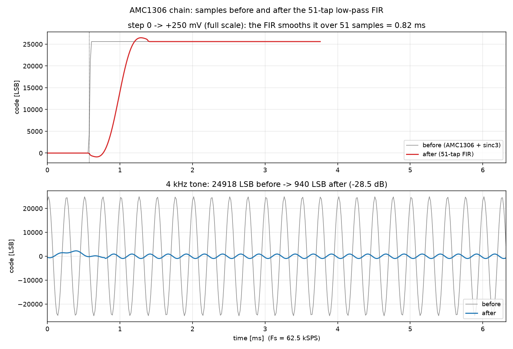

# AMC1306 采样模块 + FIR 低通（Vivado 2022.2 / xsim）

针对 `clk = 256 MHz → CLKIN 16 MHz → AMC1306M25 (DOUT 1-bit ΔΣ) → sinc3 OSR=256
→ 62.5 kSPS → 16 位有符号码 → 51 抽头 FIR 低通` 这条链路的**自校验** testbench，
激励用的是按数据手册模型生成的**真实比特流**（不是随机 0/1，也不是方波）。

```
amc1306_tb/
├─ README.md                        ← 本文件
├─ docs/spec_notes.md               ← 每条建模依据的数据手册原文 + 页码链接
└─ sim/
   ├─ gen/
   │   ├─ gen_bitstream.py          ← 比特流生成器（可重跑、可改参数）
   │   ├─ golden_cic.py             ← sinc3 定点运算的逐位等价模型
   │   ├─ golden_fir.py             ← FIR 定点运算的逐位等价模型 + 前后对比图
   │   └─ amc1306_lpf_design.m      ← MATLAB：设计滤波器并生成 .coe
   ├─ fir/
   │   ├─ amc1306_lpf_51tap.coe     ← 给 FIR Compiler IP 的系数文件
   │   ├─ fir_response.png/csv      ← 幅频响应（MATLAB 出图）
   │   └─ preview_pre_post.png      ← 滤波前后波形对比
   ├─ data/
   │   ├─ scenario.mem              ← 12 段 × 2048 bit 的测试流（TB 直接读这个）
   │   ├─ segments/*.mem            ← 同样内容按电平拆开的单段文件
   │   ├─ scenario_params.vh        ← 段长/段数/位深（TB include）
   │   ├─ scenario_table.vh         ← 每段的 Vin / 理想码 / 类型（TB include）
   │   ├─ fir_spec.vh               ← MATLAB 算出的 |H(f)| 测试点（TB include）
   │   └─ scenario_meta.csv         ← 生成时自校验的结果表（人看）
   ├─ rtl/
   │   ├─ amc1306_sample_stub.v     ← AMC1306 参考实现（换掉它就跑你自己的 RTL）
   │   ├─ fir_lpf.v                 ← 51 抽头 FIR 参考实现（综合时换 IP）
   │   ├─ fir_coefs.vh              ← MATLAB 生成的系数（RTL/TB 共用）
   │   └─ amc1306_chain.v           ← 两级串起来的顶层，含 pre/post 两路输出
   ├─ tb/
   │   ├─ tb_amc1306_sample.v       ← 链路 TB：12 个直流点 + FIR 稳态
   │   └─ tb_fir_lpf.v              ← 滤波器 TB：冲激/直流/正弦/阶跃
   └─ scripts/
       ├─ run_xsim.bat              ← 命令行一键跑
       └─ build_project.tcl         ← 生成可打开的 Vivado 工程并跑一次
```

---

## 1. 快速开始

### 方式 A：命令行（最快）

```bat
call C:\Xilinx\Vivado\2022.2\settings64.bat
cd /d <本目录>\sim\scripts
run_xsim.bat            :: 两个 TB 都跑
run_xsim.bat chain      :: 只跑链路 TB
run_xsim.bat fir        :: 只跑滤波器 TB
```

脚本会编译 → 精化 → 仿真，并把 `data/scenario.mem` 的绝对路径通过
`-testplusarg MEM=...` 传给 TB（所以 xsim 的临时运行目录在哪都不影响读文件）。

### 方式 B：Vivado GUI

```bat
vivado -mode batch -source <本目录>\sim\scripts\build_project.tcl
```

工程生成在 `amc1306_tb/../vivado_amc1306/`，里面已经配好 `include_dirs`、
顶层 `tb_amc1306_sample`、`xsim.simulate.runtime = all` 和 MEM plusarg，
直接打开 `.xpr` 点 Run Simulation 即可。只想建工程不跑：
`... -tclargs -nolaunch`。

### 期望输出

```
 seg  name                   Vin[mV]   ideal   measured  max|err|  n  fail
   0  -1.00 FS               -250.0  -25600     -25600         0   4     0
   1  -0.75 FS               -187.5  -19200     -19200         0   4     0
   ...
   8  +1.00 FS                250.0   25600      25600         0   4     0
   9  +clip 320mV             320.0   32767      32256         0   4     0
  10  -clip 320mV            -320.0  -32768     -32256         0   4     0
  11  0 + 100uV offset         0.1      10         10          0   4     0
 checks            : 50
 value errors      : 0
 worst |err|       : 0 LSB (tolerance 8)
 en gating         : 0 violations
 reset             : 0 violations
 RESULT: PASS
```

（每段 8 个输出样点，前 4 个用于 sinc3 建立期，后 4 个参与比对；过载段 `n` 为 4，
"measured" 是 32256 而不是 32767 是正常的——127/128 的密度解出来就是这个码。）

---

## 2. 接口契约

TB 按下面的端口例化 `amc1306_sample`（**这是本工程唯一需要你确认的地方**）：

| 端口 | 方向 | 位宽 | 含义 |
|---|---|---|---|
| `clk` | in | 1 | 系统时钟 256 MHz |
| `rst_n` | in | 1 | 异步复位，低有效 |
| `en` | in | 1 | 1 = 采集使能；0 = `valid` 拉低、`data` 保持 |
| `bit_in` | in | 1 | AMC1306 DOUT |
| `valid` | out | 1 | 每个输出样点一个 `clk` 脉冲（62.5 kSPS） |
| `data` | out | 16 | **有符号二进制补码**，0 对应 0 A |

隐含约定（如果你的实现不一样，见 §6 的修改点）：

- DUT 内部把 `clk` 16 分频产生 CLKIN，计数由 `rst_n` 清零，CLKIN 上升沿出现在计数为 0 时；
  TB 用同样的约数复制一份 CLKIN 去驱动比特流模型，两边天然对齐。
- 输出码定义：`code = (ones_density − 0.5) × 65536`，即 ±250 mV 满量程对应 ±25600。
  若你的 DUT 把满量程标定到 ±32767，只改 `EXP_NUM/EXP_DEN` 两个 localparam（§6）。

---

## 3. 比特测试数据是怎么来的

生成器 `sim/gen/gen_bitstream.py` 不是"随机 0/1"，它按 SBAS734C 建了一个二阶单环
ΔΣ 调制器，逐 CLKIN 输出 1 bit：

| 项 | 取值 | 依据 |
|---|---|---|
| 密度公式 | `d = 0.5 + VIN/(2×320 mV)` | 手册 p25 §8.3.4，`0.890625×65536 = 58368` 校验 |
| ±250 mV 密度 | 10.94 % / 89.06 % | 原文照抄，**不是 10/90** |
| 过载 | 127 个轨位 + 1 个反向位 | p26 §8.4.2 + Fig.54 "127 CLKIN Cycles" |
| 噪声 | 12 µV rms 输入折算 | SNR 86 dB 典型值反推 |
| 失调 | 4.5 µV | EO 典型值 |
| 斩波纹波 | 10 µV @ fCLKIN/32 | p22 §8.3.1 输入斩波频率 |

12 段测试流（每段 2048 bit = 8 个 sinc3 窗口）：

| 段 | 电平 | Vin | 密度 | 理想码 | 检查方式 |
|---|---|---|---|---|---|
| 0 | −1.00 FS | −250 mV | 10.94 % | −25600 | ±8 LSB |
| 1 | −0.75 FS | −187.5 mV | 20.70 % | −19200 | ±8 LSB |
| 2 | −0.50 FS | −125 mV | 30.47 % | −12800 | ±8 LSB |
| 3 | −0.25 FS | −62.5 mV | 40.23 % | −6400 | ±8 LSB |
| 4 | 0 | 0 mV | 50.00 % | 0 | ±8 LSB |
| 5 | +0.25 FS | +62.5 mV | 59.77 % | +6400 | ±8 LSB |
| 6 | +0.50 FS | +125 mV | 69.53 % | +12800 | ±8 LSB |
| 7 | +0.75 FS | +187.5 mV | 79.30 % | +19200 | ±8 LSB |
| 8 | +1.00 FS | +250 mV | 89.06 % | +25600 | ±8 LSB |
| 9 | 过载 | +320 mV | 99.22 % | — | 只要求 > +24000 |
| 10 | 过载 | −320 mV | 0.78 % | — | 只要求 < −24000 |
| 11 | 零漂移 | +100 µV | 50.00 % | +10 | ±8 LSB |

生成器自己会用**和 RTL 逐位一致的 CIC 参考模型**把这些比特解回码，和理想值比对，
结果写在 `data/scenario_meta.csv`：**所有稳态窗口误差 0 LSB**（最大 1 LSB 出现在
带噪声的零点段）。也就是说，激励本身的精度远高于 8 LSB 的判据，判据留的余量是给
DUT 的实现差异（舍入、截位、增益/失调修正）用的。

想换电平/换器件/换长度：

```bat
python gen_bitstream.py --part m25 --seg-bits 2048 --seed 7
python gen_bitstream.py --part m05            # ±50 mV、钳位 ±64 mV
python gen_bitstream.py --noise-uv 0 --chop-uv 0   # 干净流，用于排查 DUT 自身问题
```

重跑后 `scenario.mem` 和两个 `.vh` 会一起更新，TB 不用改（段数、段长、理想码都从 `.vh` 来）。

---

## 4. FIR 低通滤波器

### 4.1 设计（由 MATLAB 实际运行生成）

`sim/gen/amc1306_lpf_design.m` 用 `firpm`（Parks-McClellan 等波纹）设计：

| 参数 | 值 |
|---|---|
| 采样率 Fs | 62.5 kSPS（AMC1306 链路输出率） |
| 通带 / 阻带 | 1 kHz / 2.5 kHz |
| 阶数 | 50（**51 抽头**） |
| 系数 | 16 bit 有符号，和为 32768（= 2^15，直流增益 1.0） |

实测（对**量化后**的整数系数算的，不是理想浮点）：

| 指标 | 实测 |
|---|---|
| 通带纹波（0–1 kHz） | **1.42 dB** |
| 阻带最差衰减（≥2.5 kHz） | **28.4 dB** |
| −3 dB 点 | 1311 Hz |
| 群延迟 | 25 样本 = **0.40 ms** |
| \|H\| @ 1 k / 2.5 k / 4 k / 12 kHz | 0.8496 / 0.0376 / 0.0377 / 0.0067 |

> **必须说清楚的一点**：51 抽头在 62.5 kSPS 下做 1 k→2.5 k 的过渡带（只有 2.4% Fs）
> 是**不够的**。Kaiser 估算要达到 50 dB 需要约 122 抽头。目前这版是"能用的最小实现"，
> 不是"达标的实现"。两个改法，脚本里都只改一行：
>
> 1. **加抽头**：`Order = 122`，`.coe` / `fir_coefs.vh` 自动重生成，RTL 和 TB 无需改
>    （`TAPS` 从生成文件来）。
> 2. **先抽取再滤**：链路上先 /4 抽取到 15.625 kSPS，过渡带变成 9.6% Fs，51 抽头就能到
>    ~78 dB（Kaiser 估算），乘法器还少 4 倍。这是电机电流环更常见的做法。

### 4.2 生成的文件

| 文件 | 用途 |
|---|---|
| `sim/fir/amc1306_lpf_51tap.coe` | 给 Xilinx FIR Compiler IP（`radix=10`） |
| `sim/rtl/fir_coefs.vh` | 同样的整数，给 RTL / TB 用 |
| `sim/data/fir_spec.vh` | 各测试点的 \|H\|，TB 拿它做判据 |
| `sim/fir/fir_response.png` | 幅频响应 + 系数（`.csv` 是同一份数据） |

### 4.3 装进 FIR Compiler IP（Vivado 2022.2）

`IP Catalog → FIR Compiler`，关键项：

| 项 | 设置 |
|---|---|
| Coefficient Source | **COE File** → 选 `amc1306_lpf_51tap.coe` |
| Filter Specification | **Single Rate**（输入 62.5 kSPS，输出同速率） |
| Number of Coefficients | 51 |
| Coefficient Width / **Fractional Bits** | 16 / **15** ← 关键，见下 |
| Input Data Width | 16，**Signed** |
| Output Width | 16，Signed，可选 Saturate |
| Coefficient Structure | **Symmetric**（系数对称，乘法器减半） |
| Implementation | Multiply-Accumulate（面积小）或 Systolic（吞吐高） |

**Fractional Bits = 15 是最容易错的地方**：`.coe` 里是整数（和 = 32768），只有告诉 IP
"这 16 位里有 15 位是小数"，它才会把 32768 解释成 1.0，输出才和输入同量纲（直流增益
1.0）。如果留在整数模式，输出会被放大 2^15 倍直接饱和到 32767 —— 这是最常见的
"一上电就满量程"故障。

不想动 fractional bits 也可以：整数模式 + 输出右移 15 位，效果等价（`fir_lpf.v`
就是这么做的）。

### 4.4 滤波前后发生了什么

`sim/fir/preview_pre_post.png`（由 `golden_fir.py --plot` 用逐位等价的定点模型跑出来）：



| 场景 | 滤波前 | 滤波后 |
|---|---|---|
| 阶跃 0 → +250 mV | 1 个样本内跳完 | 51 样本（0.82 ms）平滑上升，过冲 +2.3%、预振铃 −5% |
| 4 kHz 正弦（250 mV） | 24918 LSB | **940 LSB（−28.5 dB）** |
| 直流 | 原值 | 原值（增益 1.000） |

xsim 里 `tb_fir_lpf` 会打出同样的数字（见 4.5），两边用的是同一套定点运算。

### 4.5 TB 检查了什么

`tb_fir_lpf` 直接以每周期 1 个样本灌入（最大吞吐，不受 62.5 kSPS 的真实时间约束）：

1. **冲激响应**逐点比对 `(20000×coef)>>15` —— 验证 RTL 的乘加/移位/饱和与 MATLAB 系数完全一致；
2. **直流增益** 10000 → 10000（±2 LSB）；
3. **幅频**：1 k / 2.5 k / 4 k / 12 kHz 四个点，与 MATLAB 的 `|H|` 比对（误差 <5%）；
4. **阶跃**：过冲 <+5%、预振铃 >−10%（线性相位 FIR 的正常行为）；
5. 打印 4 kHz 的**逐样本前后对比表**。

`tb_amc1306_sample` 里额外做一件事：直流扫描结束后保持 −250 mV，让 FIR 建立 70 个
样本，检查 `post` 是否稳定在 −25600 ± 8 LSB，并统计 `valid_post` 脉冲数。

---

## 5. TB 都检查了什么

1. **数值正确性**：每个 `valid` 的 `data` 与理想码比，线性段判据 ±8 LSB（`TOL_LSB`）。
2. **跳变建立**：每段电平切换后丢弃前 4 个样点（`SETTLE`，sinc3 三阶梳状需要 3 个窗口建立）。
3. **过载行为**：±320 mV 段只要求码值超出 ±250 mV 满量程，允许 DUT 自己决定饱和方式
   （钳到 ±32767 或输出 ±32256 都算通过）。
4. **输出速率**：每段 `valid` 数量应为 8（±1），能抓出 OSR 配错、多打/漏打 `valid`。
5. **`en` 门控**：中途拉低 `en` 600 个 CLKIN 周期，检查期间 `valid` 必须为低；
   重新使能后继续比对（跳过 4 个样点）。
6. **复位**：复位期间 `valid` 必须为低。
7. **看门狗**：`BIT_DEPTH×DIV×3` 个 clk 内没跑完就报超时，防止死等。

---

## 6. 换成你自己的 DUT

1. 删掉 `sim/rtl/amc1306_sample_stub.v`（或从仿真源里移除），
   把你的 `amc1306_sample.v` / `.vhd` 加进来，**模块名和端口名保持一致**。
2. 如果你的模块有自己的 CLKIN 输出（例如 `clk_out`），把 TB 里
   `wire clkin = ~div_cnt[3];` 换成接你的 `clk_out`，并删掉 `div_cnt` 那段——
   这样时钟相位完全一致，比特流的 tD 关系才严格成立。
3. 如果你的满量程标定不是 ±25600：

   ```verilog
   localparam integer EXP_NUM = 32767;   // ±250 mV 对应的码
   localparam integer EXP_DEN = 25600;
   ```

4. 如果容差不够/太松：改 `TOL_LSB`（默认 8）。噪声大的实现可以放到 20~30；
   想验"纯算法"就把生成器的 `--noise-uv 0 --chop-uv 0` 跑一版。
5. 其它可调：`DIV`（分频比）、`OSR`（抽取比）、`SETTLE`、`TD_PS`（tD 建模值）。

---

## 7. 排错

| 现象 | 原因 / 处理 |
|---|---|
| `ERROR: cannot open the bitstream file` | 没传 `MEM` plusarg，或路径有空格没加引号。用 `run_xsim.bat`，或手动 `-testplusarg "MEM=D:\...\scenario.mem"` |
| 编译报 `scenario_params.vh` 找不到 | 没把 `sim/data` 加进 include 目录（GUI：Simulation Settings → Compilation → include dirs） |
| 所有段都差固定值（±25600 之类） | `EXP_NUM/EXP_DEN` 或 DUT 的满量程定义不对，见 §6.3 |
| 只有前几段对、后面错位 | DUT 的 `valid` 速率不是每 256 个 CLKIN 一次，看 report 里 "valid output rate" |
| `en=0` 时 `valid` 仍为高 | DUT 没做门控，或 `en` 打拍后晚了一拍（TB 允许 1 拍宽限） |
| 最坏误差在 ±300 LSB 量级 | 典型是比对窗口错位/没跳过建立期：把 `SETTLE` 加到 6 |

---

## 8. 验证状态（请先看这条）

- ✅ **比特数据已在本机用 Python 全量校验**：密度、逐窗口 sinc3 解码、理想码对比都跑过，
  `scenario_meta.csv` 里是实测结果（稳态 0 LSB）。
- ✅ **RTL 的定点运算也用逐位等价模型验证过**：`gen/golden_cic.py` 复刻了
  `amc1306_sample_stub.v` 的 32 位补码运算（含 CIC 积分器的有意环绕），
  对同一份 `scenario.mem` 解出的码与理想值**逐段 0 LSB**，说明"数据 + 期望码 + RTL 数据通路"
  三者自洽：如果 xsim 里你这个 DUT 跑出别的结果，问题在 DUT 或 TB 的时序/端口，不在激励。
- ✅ **滤波器系数由本机 MATLAB R2025b 实跑生成**（不是手算/拟合）：`.coe`、`fir_coefs.vh`、
  响应曲线、`|H|` 测试点都来自同一次 `firpm` 运行；`gen/golden_fir.py` 用逐位等价的定点模型
  复核：冲激响应与系数表**0 LSB 误差**，直流增益 0 LSB，四个频点的 \|H\| 与 MATLAB 相差
  **<0.3%**。
- ⚠️ **RTL 与 testbench 未在本机编译/仿真过**：这台机器上没装 Vivado（`xvlog/xsim`
  不在 PATH，`C:\AMD` 下只有 Chipset_Software），所以 Verilog 部分是按 Vivado 2022.2 /
  xsim 的语言子集写的，但没有实际跑过一次编译。第一次运行时如果报语法错，大概率集中在
  三处：`$value$plusargs` 的字符串寄存器、`%0s` 打印定长字符串、`$log10`——前两处只影响
  日志，第三处只影响 dB 打印，都是单行改动。
- 数据手册引用见 `docs/spec_notes.md`，其中明确标注了哪几条是**原文**、哪几条是**反解**、
  哪几条**取不到**（Equation 1 是图片、"Test Pattern" 内容未公开）。
