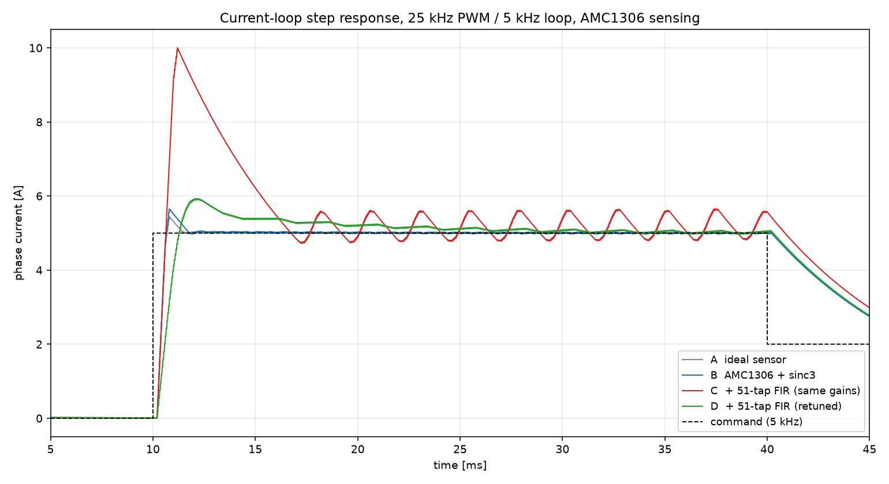

# 25 kHz 载波 / 5 kHz 电流环仿真：AMC1306 采样 + 51 抽头 FIR 的影响

对比同一套电流闭环在**接入 51 抽头 FIR 前后**的响应：25 kHz PWM、5 kHz 电流环更新、
AMC1306（1-bit ΔΣ + sinc3 OSR 256）采样。

## 结论先行

| | 理想传感器 | AMC1306 + sinc3 | + 51 抽头 FIR（同一组增益） | + FIR（重调增益） |
|---|---|---|---|---|
| PI 带宽 | 800 Hz | 800 Hz | 800 Hz | **150 Hz** |
| 上升时间 | 0.37 ms | 0.37 ms | 0.36 ms | 0.83 ms |
| 过冲 | 7.8 % | 11.8 % | **98 %** | 18.3 % |
| 建立（±2 %） | 1.33 ms | 1.62 ms | **不收敛** | 18.4 ms |
| 稳态纹波 | 0.052 A | 0.042 A | 0.85 A | 0.112 A |

**一句话**：51 抽头 FIR 在 62.5 kSPS 下带来 **0.40 ms 群延迟**，是 5 kHz 控制周期（0.2 ms）的两倍。
同一组 PI 增益下电流环直接失稳（98 % 过冲、持续振荡）；把带宽从 800 Hz 压到 150 Hz 才勉强稳定，
但响应慢到 18 ms 才建立。**这个滤波器不能放在 5 kHz 电流环的反馈通道里。**



## 系统结构

```
I* (5 kHz 阶跃) ──► PI ──► PWM 25 kHz ──► R-L 负载
                    ▲                        │
                    │                        ▼
              51-tap FIR ◄── sinc3 OSR 256 ◄── AMC1306 (1-bit ΔΣ, 16 MHz)
```

采样链路是 `../sim` 里那份**已与 RTL 逐位对齐**的模型：调制器密度
`0.5 + VIN/640 mV`、CIC 32 位环绕运算、FIR `(Σcoef·x)>>15`。滤波器系数直接读
`../sim/fir/amc1306_lpf_51tap.coe`，与 FPGA 工程同一份。

## 参数

| 项 | 值 |
|---|---|
| 母线电压 Vdc | 24 V |
| 电枢 R / L | 0.25 Ω / 2 mH（τ = 8 ms） |
| 分流电阻 | 25 mΩ → ±10 A ↔ ±250 mV（5 A 时 50 % 量程，留余量） |
| ADC 分辨率 | 2560 LSB/A |
| PWM | 25 kHz，三角载波，占空比分辨率 1 % |
| 电流环 | 5 kHz（200 µs），PI + 前馈 |
| 仿真步长 | 0.25 µs，60 ms |
| 指令 | 10 ms: 0→5 A；40 ms: 5→2 A |

PI 参数按极点-零点对消设计：`Kp = ωc·L/Vdc`，`Ki = Kp·R/L`。

**采样相位的处理**：ADC 以 62.5 kSPS 连续转换，但控制量在**载波谷点锁存**（每 40 µs 一次），
这是真实驱动的常规做法。不做锁存的话（直接用最新一次转换值），采样点相对载波每周期漂移
（62.5/25 = 2.5 个采样/周期），开关纹波会混进反馈，模型里会出现与滤波器无关的假振荡。

## 运行

```bat
cd current_loop_sim\sim
python amc1306_loop.py        :: 四个工况 + 出图，约 5 s
python sweep_bandwidth.py     :: 接入 FIR 后扫 PI 带宽，看稳定边界
```

输出：`results/metrics.csv`、`results/step_response.png`、`results/steady_state_zoom.png`。

## 带宽扫描（接入 FIR）

| PI 带宽 | 上升 | 过冲 | 建立 | 纹波 |
|---|---|---|---|---|
| 80 Hz | 1.76 ms | 13.7 % | 25.8 ms | 0.124 A |
| 120 Hz | 1.08 ms | 13.5 % | 21.3 ms | 0.114 A |
| 150 Hz | 0.83 ms | 18.3 % | 18.4 ms | 0.112 A |
| 200 Hz | 0.61 ms | 31.3 % | 19.6 ms | 0.110 A |
| 300 Hz | 0.42 ms | 61.4 % | 19.0 ms | 0.112 A |
| 400 Hz | 0.36 ms | 78.4 % | 12.2 ms | 0.102 A |
| 800 Hz | 0.36 ms | 98.1 % | 不收敛 | 0.854 A |

150 Hz 以下过冲可控，但建立时间始终在 18 ms 以上——**延迟已经把阻尼限制死了**，
不是调增益能解决的。

## 为什么延迟这么致命

环路里除了 FIR 还有三处延迟，加起来才是全部代价：

| 环节 | 延迟 |
|---|---|
| sinc3（OSR 256） | ≈ 1.5 输出样本 = 24 µs |
| **51 抽头 FIR @ 62.5 kSPS** | **25 样本 = 400 µs** |
| 控制周期量化（5 kHz） | 0 ~ 200 µs，平均 100 µs |
| PWM 零阶保持 | 20 µs |

FIR 一项就占了总延迟的 **70 %**。相位裕度 `PM ≈ 90° − ωc·Td`，取 Td ≈ 0.55 ms：

- ωc = 800 Hz → PM ≈ −68°（必定振荡，与仿真一致）
- ωc = 150 Hz → PM ≈ 60°（可稳定，但慢）

## 一个容易搞反的点：抽取方向

上一份报告里建议"先 /4 抽取到 15.625 kSPS 再用 51 抽头"，那只对**阻带抑制/每抽头效率**成立，
对**延迟**是反的：

| 方案 | 群延迟 |
|---|---|
| 51 抽头 @ 62.5 kSPS | 25 × 16 µs = **0.40 ms** |
| 51 抽头 @ 15.625 kSPS | 25 × 64 µs = **1.60 ms**（差 4 倍） |
| 122 抽头 @ 62.5 kSPS（达 50 dB） | 60.5 × 16 µs = **0.97 ms** |

延迟 = `(N−1)/(2·Fs)`：**降低采样率会把同样的抽头数放大成更长的延迟**。对控制环来说这是反向操作。

## 那该怎么办

1. **别把它放进反馈通道**——1 kHz 通带、2.5 kHz 阻带的 FIR 与 5 kHz 电流环在延迟预算上根本冲突。
   反馈用 sinc3 直出（24 µs）已经够干净（本次仿真里 sinc3 让过冲从 7.8 % 升到 11.8 %，仍可用）。
2. **要是为了抑制 PWM 纹波**，用载波同步采样即可（本模型已经这么做了），不需要长 FIR。
3. **要是为了抑制高频噪声/抗混叠**，把滤波器放在**抽取之前**（16 MHz 侧），同样的时间延迟下
   可以拿到多得多的抽头。
4. **确实要滤**，就把通带降到 300 Hz 量级（N 减到 ~20 抽头，延迟 ~0.15 ms），并接受电流环带宽
   降到 200~300 Hz。

## 文件

```
current_loop_sim/
├─ README.md                  ← 本文件
├─ sim/amc1306_loop.py        ← 模型 + 四个工况 + 出图
├─ sim/smith_study.py         ← Smith 预测器：Bode 分析 + 闭环对比
├─ sim/sweep_bandwidth.py     ← 带宽扫描
└─ results/
   ├─ metrics.csv             ← 四个工况的指标
   ├─ step_response.png       ← 阶跃响应对比
   └─ steady_state_zoom.png   ← 稳态纹波放大
```

## 局限

- 负载是线性 R-L，没有反电动势、磁饱和、死区；逆变器按理想开关建模（0/24 V）。
- 只在 5 A / 2 A 两个工作点附近验证，没有扫全量程。
- 死区、管压降、电流纹波引入的噪声未被建模；实际纹波会比这里大。
