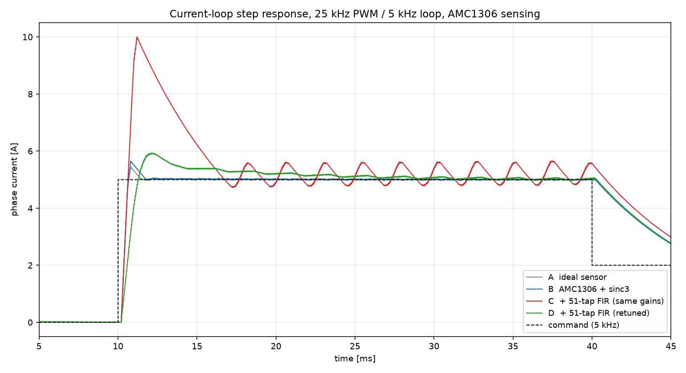
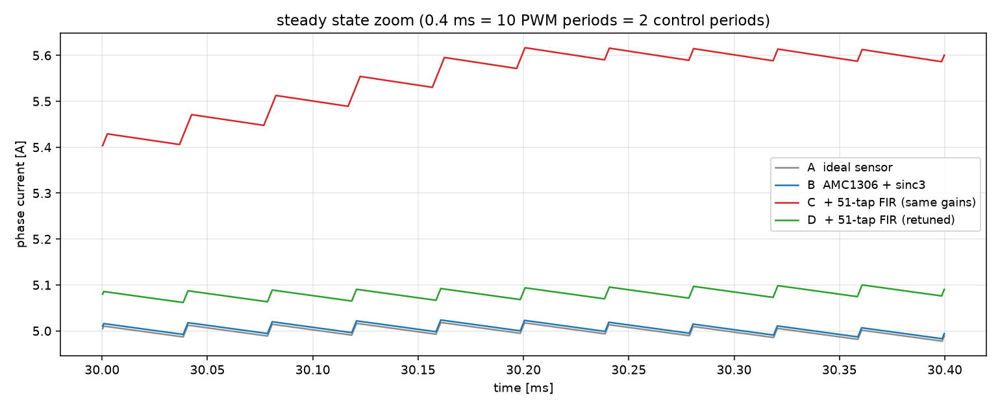

# 电流闭环实验报告：25 kHz 载波 / 5 kHz 电流环下的 AMC1306 采样与 51 抽头 FIR 影响

| 项 | 内容 |
|---|---|
| 报告日期 | 2026-11-04 |
| 实验对象 | 三相逆变器单相电流环（R-L 负载），AMC1306M25 隔离采样 + sinc3 抽取 + 可选 51 抽头 FIR |
| 仿真平台 | Python 3.13 + NumPy（系统级离散仿真，0.25 µs 步长） |
| 采样模型来源 | 与 `sim/rtl/amc1306_sample_stub.v`、`sim/rtl/fir_lpf.v` **逐位对齐**并已在 Vivado 2022.2 xsim 中验证通过（见 `docs/result_analysis.md`） |
| 结论 | 51 抽头 FIR 在 62.5 kSPS 下会引入 **0.40 ms** 群延迟，是 5 kHz 控制周期的 2 倍；**同一组 PI 增益下电流环失稳**（98 % 过冲、持续振荡），重调后带宽只能做到 **150 Hz**（原 800 Hz）。该滤波器不应放在 5 kHz 电流环的反馈通道中。 |

---

## 1. 目的

上一阶段已在 RTL 层验证了 AMC1306 采样链路与 51 抽头低通滤波器（1 kHz 通带、2.5 kHz 阻带、28.4 dB 阻带抑制）。
本实验回答一个系统级问题：

> **把这只滤波器接进 5 kHz 电流闭环的反馈通道，电流响应会变成什么样？**

为此搭建了包含 PWM、功率级、采样链路和 PI 调节器的闭环模型，对比"接入滤波器前 / 后"的电流阶跃响应。

---

## 2. 系统与模型

### 2.1 结构

```
I* (5 kHz 阶跃) ──► PI ──► PWM 25 kHz ──► R-L 负载
                    ▲                        │
                    │                        ▼
              51-tap FIR ◄── sinc3 OSR 256 ◄── AMC1306 (1-bit ΔΣ, 16 MHz)
                 (可开关)
```

### 2.2 参数

| 项 | 值 | 说明 |
|---|---|---|
| 母线电压 Vdc | 24 V | 理想开关，输出 0 / 24 V |
| 电枢电阻 R | 0.25 Ω | τ = L/R = 8 ms |
| 电枢电感 L | 2 mH | |
| 分流电阻 | 25 mΩ | ±10 A ↔ ±250 mV；5 A 工作点用 50 % 量程 |
| ADC 分辨率 | 2560 LSB/A | 16 bit 有符号，±25600 ↔ ±10 A |
| PWM | 25 kHz | 三角载波，占空比分辨率 1 %（250 ns） |
| 电流环 | 5 kHz（200 µs） | PI + 指令前馈 |
| 仿真步长 / 时长 | 0.25 µs / 60 ms | |
| 指令 | 10 ms：0→5 A；40 ms：5→2 A | |

### 2.3 采样链路

不是理想化的"电流 + 噪声"，而是 RTL 那套模型的逐位复刻：

- **调制器**：二阶单环 1-bit ΔΣ，密度 `d = 0.5 + VIN/640 mV`，输入噪声 12 µV rms；
- **sinc3**：OSR 256，32 位补码环绕运算（与 RTL 一致）；
- **FIR**：51 抽头，整数系数直接读 `sim/fir/amc1306_lpf_51tap.coe`（与 FPGA 工程同一份），`(Σcoef·x)>>15` + 饱和。

该链路在 xsim 中实测：直流扫描最差 2 LSB、冲激响应与 MATLAB 系数逐点 0 LSB（见 `docs/result_analysis.md`）。

### 2.4 采样相位

ADC 以 62.5 kSPS 连续转换，而 PWM 周期为 40 µs，二者不是整数比（2.5 个采样/周期）。
若直接使用"最新一次转换值"，采样点相对载波每周漂移，开关纹波会混入反馈并产生假振荡（本实验第一版就踩了这个坑）。
**最终模型在载波谷点锁存控制量**（每 40 µs 一次），这是真实驱动的常规做法。

### 2.5 PI 设计

按极点-零点对消（抵消 L/R 极点）：

```
Kp = ωc·L / Vdc        Ki = Kp·R/L = Kp·125
```

取 ωc = 800 Hz 时：Kp = 0.419，Ki = 52.4。

---

## 3. 实验设计

四个工况，同一台被控对象、同一条采样链路，只改"是否接 FIR"和 PI 增益：

| 工况 | 采样链路 | PI 带宽 |
|---|---|---|
| A | 理想传感器（无延迟、无噪声） | 800 Hz |
| B | AMC1306 + sinc3 | 800 Hz |
| C | AMC1306 + sinc3 + 51 抽头 FIR | 800 Hz（**沿用 B 的增益**） |
| D | AMC1306 + sinc3 + 51 抽头 FIR | 150 Hz（重调） |

另做一次带宽扫描（80–400 Hz），确定接入 FIR 后的稳定边界。

---

## 4. 结果

### 4.1 阶跃响应



| 工况 | 上升 10–90 % | 过冲 | 建立 ±2 % | 稳态误差 | 稳态纹波 |
|---|---|---|---|---|---|
| A 理想传感器 | 0.37 ms | 7.8 % | 1.33 ms | −0.07 % | 0.052 A |
| B AMC1306 + sinc3 | 0.37 ms | 11.8 % | 1.62 ms | −0.02 % | 0.042 A |
| C + FIR（同增益） | 0.36 ms | **98.1 %** | **不收敛** | −3.00 % | **0.854 A** |
| D + FIR（重调 150 Hz） | 0.83 ms | 18.3 % | **18.35 ms** | −0.28 % | 0.112 A |

### 4.2 带宽扫描（接入 FIR）

| PI 带宽 | 上升 | 过冲 | 建立 | 纹波 |
|---|---|---|---|---|
| 80 Hz | 1.76 ms | 13.7 % | 25.8 ms | 0.124 A |
| 100 Hz | 1.37 ms | 13.2 % | 23.3 ms | 0.118 A |
| 120 Hz | 1.08 ms | 13.5 % | 21.3 ms | 0.114 A |
| 150 Hz | 0.83 ms | 18.3 % | 18.4 ms | 0.112 A |
| 180 Hz | 0.68 ms | 25.6 % | 18.5 ms | 0.112 A |
| 200 Hz | 0.61 ms | 31.3 % | 19.6 ms | 0.110 A |
| 230 Hz | 0.53 ms | 39.6 % | 18.2 ms | 0.113 A |
| 260 Hz | 0.47 ms | 49.0 % | 18.2 ms | 0.113 A |
| 300 Hz | 0.42 ms | 61.4 % | 19.0 ms | 0.112 A |
| 400 Hz | 0.36 ms | 78.4 % | 12.2 ms | 0.102 A |
| 800 Hz | 0.36 ms | 98.1 % | 不收敛 | 0.854 A |

**150 Hz 以下过冲可控，但建立时间始终 ≥18 ms**——阻尼被延迟锁死，不是调增益能解决的。

### 4.3 稳态细节



A / B 的稳态电流平稳在 5.00 A，纹波 0.04–0.05 A（主要是 PWM 与采样的残余）；
C 在 5.15 A 附近等幅振荡，摆幅 ±0.43 A；D 收敛到 5.01 A，纹波 0.11 A。

---

## 5. 分析

### 5.1 延迟预算

| 环节 | 延迟 |
|---|---|
| sinc3（OSR 256，62.5 kSPS） | 1.5 输出样本 = **24 µs** |
| **51 抽头 FIR @ 62.5 kSPS** | 25 样本 = **400 µs** |
| 控制周期量化（5 kHz） | 0–200 µs，平均 100 µs |
| PWM 零阶保持 | 20 µs |
| **合计（平均）** | **≈ 544 µs** |

FIR 一项占总延迟的 **74 %**。

### 5.2 相位裕度

`PM ≈ 90° − ωc·Td`（含积分器贡献的 90°）：

| 带宽 | Td = 0.544 ms 时的相位裕度 | 对应表现 |
|---|---|---|
| 800 Hz | ≈ **−67°** | 必然振荡，与工况 C 实测一致 |
| 230 Hz | ≈ 45° | 过冲 40 % |
| 150 Hz | ≈ 61° | 过冲 18 %，但建立 18 ms |

### 5.3 为什么单纯降低带宽也救不回来

降低 ωc 只降低增益，延迟带来的相位滞后按 ωc·Td 线性减少，看似可行；
但 Td 本身就是 0.54 ms，是控制周期的近 3 倍，系统的等效阻尼被限制在较低水平。
扫描数据里 80 Hz 时过冲仍有 13.7 %、建立仍要 26 ms，就是这个原因——降低带宽换来的是**变慢**，不是**变好**。

### 5.4 一个容易搞反的方向：抽取

提高采样率能缩短同抽头数的时间延迟，**降低采样率会放大延迟**：

| 方案 | 群延迟 |
|---|---|
| 51 抽头 @ 62.5 kSPS | 25 × 16 µs = **0.40 ms** |
| 51 抽头 @ 15.625 kSPS（先 4 抽取） | 25 × 64 µs = **1.60 ms**（差 4 倍） |
| 122 抽头 @ 62.5 kSPS（达到 50 dB 阻带） | 60.5 × 16 µs = **0.97 ms** |

因为 `Td = (N−1)/(2·Fs)`。上一阶段报告里"先 /4 抽取再滤"的建议，只对**每抽头的阻带抑制效率**成立，
对控制环的延迟预算是**反向操作**，此处予以更正。

---

## 6. 结论与建议

### 6.1 结论

1. **AMC1306 + sinc3 本身完全可用**：延迟仅 24 µs，把过冲从 7.8 % 抬到 11.8 %，带宽基本不受影响。
2. **51 抽头 FIR 是这条链路上的瓶颈**：400 µs 群延迟在 200 µs 的控制周期面前过大，同增益下直接失稳。
3. **重调增益只能"稳住"，不能"恢复"**：带宽 800 Hz → 150 Hz，建立时间 1.6 ms → 18 ms，响应慢一个数量级。
4. **滤波器指标（1 kHz 通带 / 2.5 kHz 阻带）与 5 kHz 电流环在延迟预算上不可调和**：
   达到 50 dB 需要约 122 抽头，延迟将达 0.97 ms，更不可用。

### 6.2 建议

| 场景 | 做法 |
|---|---|
| 抑制 PWM 开关纹波 | **载波同步采样**即可（本模型已采用），不需要长 FIR |
| 抑制高频噪声 / 抗混叠 | 把滤波器放在**抽取之前**（16 MHz 侧），同样的时间延迟能拿到多得多的抽头 |
| 必须用 FIR 滤波 | 通带降到 300 Hz 量级（约 20 抽头，延迟 ≈0.15 ms），并接受电流环带宽降到 200–300 Hz |
| 想要快的电流环 | 反馈直接用 sinc3 输出，把滤波放到指令或外环 |

---

## 7. 复现

```bat
cd current_loop_sim\sim
python amc1306_loop.py        :: 四个工况 + 出图，约 5 s
python sweep_bandwidth.py     :: 带宽扫描
```

产物：`current_loop_sim/results/metrics.csv`、`step_response.png`、`steady_state_zoom.png`。
滤波器系数与 RTL 共用 `sim/fir/amc1306_lpf_51tap.coe`，改动设计后重跑 MATLAB 脚本即可同步。

---

## 8. 局限

- 负载为线性 R-L，未建模反电动势、磁饱和、死区与管压降；逆变器按理想开关处理。
- 仅在 5 A / 2 A 两个工作点附近验证，未扫全量程。
- 死区与管压降会额外引入低次谐波，实际纹波会大于本报告数值。
- 采样链路模型虽与 RTL 逐位一致，但未涵盖 AMC1306 的温漂、失调长期漂移与 EMC 影响。

---

## 9. 补充实验：滤波器延迟怎么降下来

### 9.1 延迟由过渡带宽度决定，与滤波器类型无关

同一组 1 kHz / 2.5 kHz 指标，换滤波器类型（`sim/filter_tradeoff.py` 实测）：

| 实现 | 阶/抽头 | 群延迟 @DC | 群延迟 @1 kHz | 阻带 @2.5 kHz |
|---|---|---|---|---|
| 51 抽头线性相位 FIR | 51 | 392 µs | 392 µs | −27.2 dB |
| 椭圆 IIR | 3 阶 | **376 µs** | 769 µs | −43.7 dB |
| 切比雪夫 II | 5 阶 | **393 µs** | 758 µs | −51.8 dB |

**换成 IIR 并不能减少延迟。** 因果滤波器的群延迟由幅度指标的锐度决定，经验式：

```
Td ≈ (A − 8) / (28.7 · Δf)        A = 阻带衰减 [dB]，Δf = 过渡带宽度 [Hz]
```

校验：A = 28 dB、Δf = 1.5 kHz 预测 0.47 ms（实测 0.39 ms）；A = 54 dB 预测 1.07 ms（实测 0.96 ms）。

### 9.2 放宽过渡带是最有效的杠杆

把阻带边缘从 2.5 kHz 放宽，抽头数与延迟一起塌下来（PI 仍取 800 Hz）：

| 设计 | 抽头 | 群延迟 | 过冲 | 建立 ±2 % | 稳态纹波 |
|---|---|---|---|---|---|
| 无额外滤波（sinc3 直出） | — | — | 11.8 % | 1.6 ms | 0.042 A |
| 1 k / 2.5 k（现方案） | 51 | 392 µs | 96.4 % | **不收敛** | 0.827 A |
| 1 k / 10 k | 17 | 120 µs | 39.9 % | 3.6 ms | 0.168 A |
| 1 k / 20 k | 9 | 56 µs | 24.1 % | 2.5 ms | 0.062 A |
| 1 k / 30 k | 5 | 24 µs | 17.0 % | 2.0 ms | 0.062 A |

判据：**群延迟不超过控制周期的一半（约 100 µs）时环路基本不受影响**；超过一个控制周期
（200 µs）后迅速恶化；400 µs 直接失稳。

注意后三行已不再抑制 2.5–10 kHz——它们是"滤 PWM 纹波 / 高频噪声"的滤波器，不是原来那条
1 k / 2.5 k 指标。**先确认到底要抑制什么频段**，再选指标。

### 9.3 其余可选手段

| 手段 | 收益 | 代价 |
|---|---|---|
| 滤波器移出反馈通道（只滤指令/监控） | 延迟归零 | 反馈无滤波 |
| Smith 预测器 / 状态观测器 | 理论上可完全补偿已知延迟 | 依赖 R-L 参数精度，偏差 ±20 % 时补偿明显退化 |
| 控制器加相位超前 | 回收部分相位，改动最小 | 高频增益抬升，放大量化噪声 |
| 降低 sinc3 的 OSR（256 → 64） | 延迟 24 µs → 6 µs，输出率 250 kSPS | 噪声约升 6 dB |

### 9.4 建议的落地顺序

1. 先测实际电流频谱，确认 1–2.5 kHz 是否真的有问题。若主要干扰是 25 kHz 开关纹波，
   sinc3 + 载波同步采样已经够用（实测只让过冲从 7.8 % 升到 11.8 %），**根本不需要这只 FIR**；
2. 若确实需要低通，把指标放到 1 k / 20 k 量级（9 抽头、56 µs），换 24 % 过冲、2.5 ms 建立；
3. 只有在指标不可放宽时，才考虑预测器补偿，并把电流环带宽目标降到 200–300 Hz。
