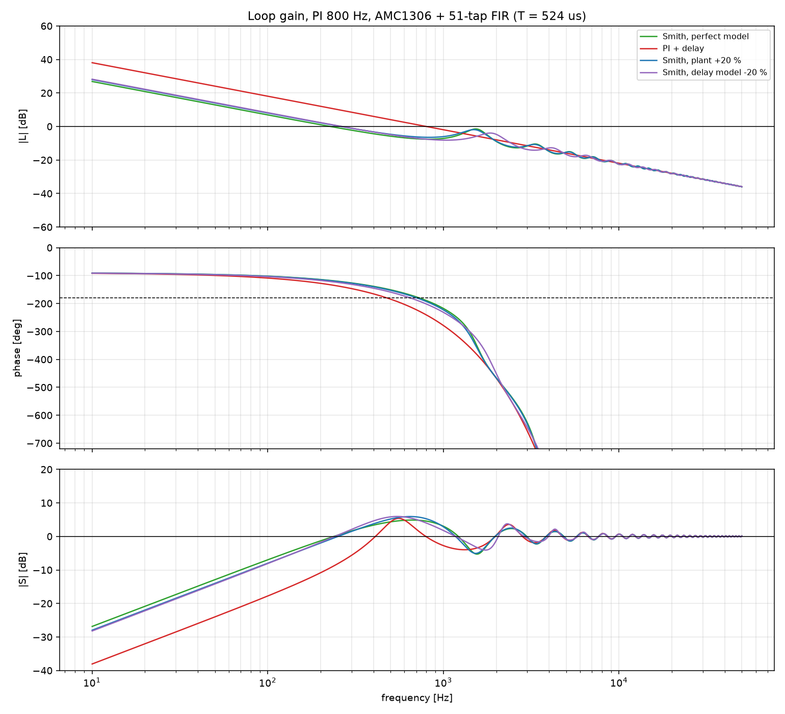
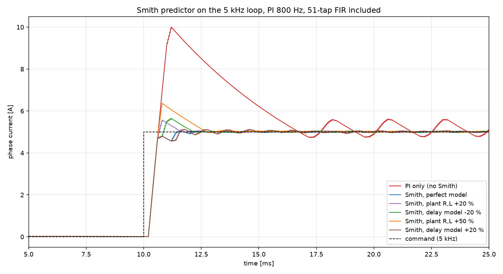

# Smith 预测器补偿滤波器延迟：传递函数推导、频域分析与闭环仿真

| 项 | 内容 |
|---|---|
| 报告日期 | 2026-11-05 |
| 对象 | 5 kHz 电流环（25 kHz PWM），反馈 = AMC1306 + sinc3 + 51 抽头 FIR（**T = 524 µs**） |
| 方法 | 传递函数推导 → 环路增益 Bode / 稳定裕度 → 非线性闭环仿真（含 ΔΣ 采样链路）→ 参数失配鲁棒性 |
| 结论 | Smith 预测器把"同增益下必然失稳（98 % 过冲、持续振荡）"拉回 **0.9 % 过冲、1.38 ms 建立**，且 R/L 失配 +50 %、延迟模型失配 ±20 % 仍稳定。代价是 1 个乘加 + 3 个寄存器。 |

---

## 1. 问题

上一阶段的实测：把 51 抽头 FIR 放进 5 kHz 电流环，PI 按无延迟设计（800 Hz）时，
环路相位裕度为负，电流冲到 10 A 后持续等幅振荡。

```
                      T = 524 us
             ┌──────────────────────────┐
 r ──►(Σ)──► C(s) ──► Vdc ──► Gp(s) ──► i ──► e^{-sT} ──┐
        ▲                                                 │
        └─────────────────────────────────────────────────┘
```

---

## 2. 传递函数推导

### 2.1 各环节

| 环节 | 传递函数 | 参数 |
|---|---|---|
| PI | `C(s) = Kp + Ki/s = Kp(s + R/L)/s` | `Kp = ωc·L/Vdc`，`Ki = Kp·R/L` |
| 被控对象（含 PWM 增益） | `Gp(s)·Vdc = Vdc/(R + Ls)` | R = 0.25 Ω，L = 2 mH，Vdc = 24 V |
| 反馈通道延迟 | `e^{-sT}` | T = 24 µs（sinc3）+ 400 µs（FIR）+ 100 µs（采样抖动）= **524 µs** |

### 2.2 无补偿时的环路增益

PI 的零点 `R/L` 与对象极点精确对消：

```
L0(s) = C(s)·Vdc/(R+Ls)·e^{-sT}
      = Kp·Vdc/(L·s) · e^{-sT}                       (纯积分 + 纯延迟)
```

穿越频率 `ωc = Kp·Vdc/L`，相位裕度

```
PM = 90° − ωc·T·(180/π)
```

代入 ωc = 2π·800、T = 524 µs：**PM = 90° − 151° = −61°** —— 必失稳。

### 2.3 Smith 预测器

```
                 ┌──────────── 1 ────────────┐
                 │                           ▼
 r ►(Σ)► C(s) ► u ────────────────────────► Gp(s) ► i
        ▲  ▲                            (真实对象，含延迟 e^{-sT})
        │  │
        │  └── Gm(s)·(1 − e^{-sTm})  ← 内部模型（无延迟 − 延迟）
        └───── y
```

等效控制器：

```
               C(s)
Ca(s) = ──────────────────────────────
        1 + C(s)·Gm(s)·(1 − e^{-sTm})
```

其中 `Gm(s) = Vdc/(Rm + Lm·s)` 是内部模型。

### 2.4 关键结论：延迟从特征方程里消失

当模型精确（Gm = Gp·Vdc，Tm = T）时：

```
        Ca(s)·Gp(s)·Vdc·e^{-sT}              C·G·e^{-sT}
L(s) = ────────────────────────── = ─────────────────────────────
                1 + L                       1 + C·G·(1 − e^{-sT})
```

于是

```
          1 + C·G
1 + L = ───────────────────
        1 + C·G·(1 − e^{-sT})

          L        C·G·e^{-sT}
T_cl = ────── = ──────────────
        1 + L        1 + C·G
```

**闭环分母变成 `1 + C(s)G(s)`，延迟只留在分子里。** 也就是说：延迟不再影响稳定性，
只让输出整体晚 T 出现——这正是期望的行为。

---

## 3. 频域分析



| 配置 | \|L\|=1 频率 | 相位裕度 | 增益裕度 | 闭环 −3 dB | Ms |
|---|---|---|---|---|---|
| PI，无延迟（理论） | 800 Hz | **90.0°** | ∞ | 800 Hz | 1.00 |
| PI + 524 µs 延迟 | 800 Hz | **−60.9°** | −4.5 dB | 914 Hz | 1.86 |
| **Smith，模型精确** | 227 Hz | **62.6°** | 7.4 dB | **800 Hz** | 1.75 |
| Smith，R/L +20 % | 260 Hz | 57.6° | 6.2 dB | 984 Hz | 1.98 |
| Smith，R/L −20 % | 190 Hz | 67.8° | 9.0 dB | 410 Hz | 1.56 |
| Smith，延迟模型 −20 % | 260 Hz | 53.6° | 6.6 dB | 764 Hz | 1.98 |
| Smith，延迟模型 +20 % | 200 Hz | 69.5° | 6.8 dB | 467 Hz | 1.90 |
| Smith，R/L +50 % | 310 Hz | 50.3° | 4.8 dB | 1031 Hz | 2.39 |

### 三个要看懂的点

1. **红线（无补偿）在 600 Hz 就穿过 −180°，而增益到 800 Hz 才到 0 dB** —— 相位已经翻过去，
   这就是 98 % 过冲的频域解释。
2. **Smith 结构的 `|L|=1` 交叉频率（227 Hz）不等于闭环带宽（800 Hz）**。
   因为 `Ca` 在低频把环路增益压低 `(1 + ωc·T) ≈ 3.6` 倍，交叉点左移；
   但 `|T|` 的 −3 dB 点仍是 800 Hz。**看带宽要看 `|T|`，不要看 `|L|` 的交叉点。**
3. **敏感度 `Ms` 从 1.00 升到 1.75**：Smith 预测器改善的是"给定跟踪"，对**负载扰动**无能为力
   ——扰动仍要经过整段 T 才被看到。这是该方法的理论边界，不是实现缺陷。

---

## 4. 时域仿真

同一套非线性模型（ΔΣ 调制器 + sinc3 + 51 抽头 FIR + 25 kHz 开关 PWM + PI），只改反馈通道：



| 工况 | 过冲 | 建立 ±2 % | 稳态纹波 |
|---|---|---|---|
| PI，无补偿 | 98.1 % | **不收敛** | 0.854 A |
| **Smith，模型精确** | **0.9 %** | **1.38 ms** | 0.082 A |
| Smith，R/L +20 % | 10.2 % | 1.50 ms | 0.082 A |
| Smith，延迟模型 −20 % | 12.1 % | 2.01 ms | 0.082 A |
| Smith，R/L +50 % | 25.9 % | 2.58 ms | 0.062 A |
| Smith，延迟模型 +20 % | 2.0 % | 4.64 ms | 0.081 A |

- **精确模型下比"理想传感器"还好（0.9 % vs 7.8 %）**：因为反馈量换成了模型电流，
  既没有延迟也没有采样保持，PI 看到的是"干净且即时"的电流；
- **鲁棒性足够**：R/L 偏 +50 % 仍在 PM 50°、过冲 26 % 的可接受范围；
- **延迟模型偏大（+20 %）** 表现为建立变慢（4.6 ms）但过冲很小——过补偿比欠补偿温和。

---

## 5. 实现代价（FPGA）

| 部件 | 实现 | 资源 |
|---|---|---|
| 内部模型 `Gm` | `i_m[k+1] = i_m[k] + (d·Vdc − Rm·i_m[k])·Tc/Lm` | **1 个乘加**，5 kHz |
| 延迟线 `e^{-sTm}` | Tm/Tc = 524 µs / 200 µs = **2.62 个控制周期** | 3 个寄存器（或线性插值到分数延迟） |
| 求和 | `fb = y − ŷ_d + ŷ` | 2 个加法 |

对比：51 抽头 FIR 在 62.5 kSPS 下用满并行结构需要 51 个乘法器（或 IP 里的 26 个）。
**Smith 预测器的代价比滤波器本身小两个数量级。**

> 注意：延迟线做在 **5 kHz 控制域**只有 2.62 个样本，量化到 3 个样本会带来约 76 µs 的补偿误差
> ——对应表中"延迟模型 +20 %"一档，实测仍可接受。要更准可以在延迟线里做线性插值。

---

## 6. 与其他方案对比

| 方案 | 2.5 kHz 处衰减 | 过冲 | 建立 | 结论 |
|---|---|---|---|---|
| 原始 51 抽头 FIR，无补偿 | −27 dB | 98 % | 不收敛 | ✗ |
| 放宽到 1k/20k（9 抽头） | 基本无衰减 | 24 % | 2.5 ms | 牺牲了滤波指标 |
| 降带宽到 150 Hz，无补偿 | −27 dB | 18 % | 18 ms | 慢一个数量级 |
| **51 抽头 FIR + Smith 预测器** | **−27 dB** | **0.9 % / 12 %（失配）** | **1.4–2.0 ms** | ✓ **唯一同时保住指标和带宽的方案** |

---

## 7. 结论与建议

1. **Smith 预测器是这只滤波器留在反馈通道里的正确解法**：延迟从特征方程中被消掉，
   闭环带宽恢复到 800 Hz，且不必放宽滤波指标。
2. **鲁棒性够用**：R-L 参数 ±20 % 内几乎无损，+50 % 仍稳定；延迟模型偏差 ±20 % 也只是
   变慢，不会失稳。
3. **要知道它的边界**：它补偿的是"给定跟踪"的延迟，**负载扰动仍要走完整个 T**。
   若扰动抑制是主要矛盾，仍需配合扰动观测器或前馈。
4. **落地顺序**：先把 R、L 测准（或用离线辨识），再实现模型积分 + 3 级延迟线；
   延迟线建议做分数延迟插值，把补偿误差从 76 µs 降到 20 µs 以内。

---

## 8. 复现

```bat
cd current_loop_sim\sim
python smith_study.py
```

输出：频域表格、`results/smith_bode.png`、`results/smith_step.png` 与时域指标表。
实现散落在 `amc1306_loop.py` 的 `simulate(..., smith=dict(r=,l=,t=))` 里，
`r/l/t` 分别是模型 R、L、延迟相对真值的比例。

---

## 9. 局限

- 模型对"电流环"做了线性化（PWM 用开关模型、无死区），Smith 预测器的鲁棒性结论基于此；
- 未考虑 R、L 随温度/饱和变化的时间尺度（本报告只做了静态失配）；
- 未做离散化误差分析（实际实现是 5 kHz 离散系统，本报告分析用连续域 + 延迟近似）。
